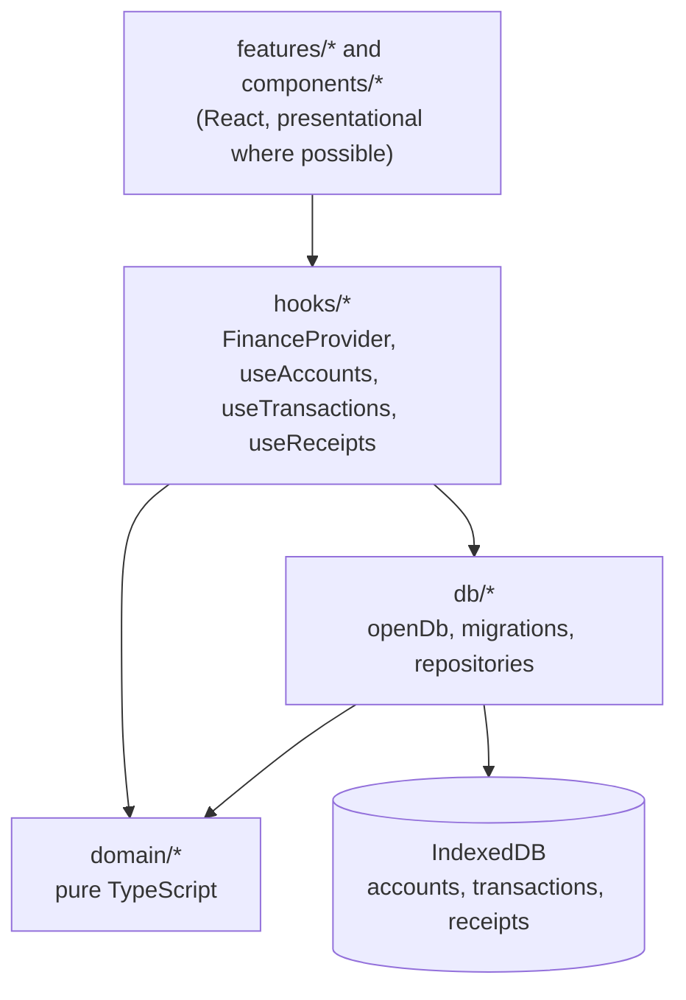
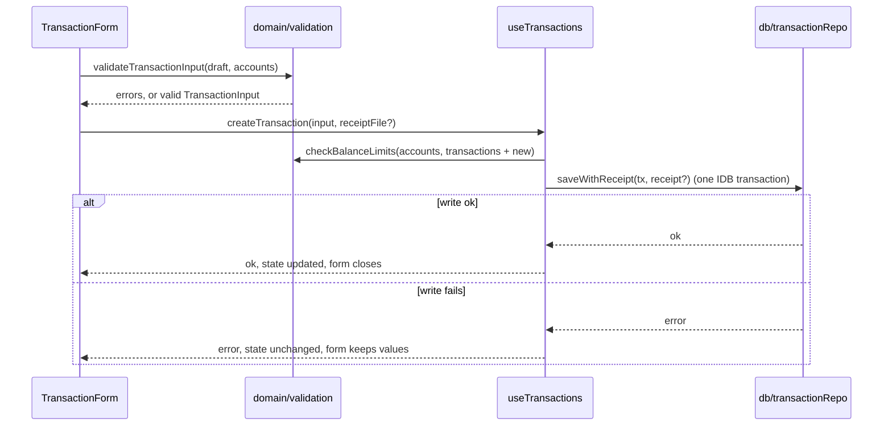

# Design Document

## Overview

The Finance_Tracker is a mobile-first, local-first single-user web app built with React, TypeScript (`strict`), Vite and plain CSS. All data lives in the browser's IndexedDB. There is no backend, authentication, cloud sync or network traffic.

The design follows the layering in `structure.md`: a pure `domain` layer, a `db` layer that alone touches IndexedDB, `hooks` that expose data to the UI, and `features`/`components` for the UI. Financial correctness is concentrated in `domain`, which is pure and is where most tests, including property-based tests, are aimed.

### Key design decisions

| Decision | Rationale |
|---|---|
| Money is integer sen with a branded `Sen` type, range ±99,999,999,999 | Avoids float errors (Req 10). The limit keeps single amounts, and realistic sums, far inside `Number.MAX_SAFE_INTEGER` (about 9.0e15). |
| Balances and summaries are derived on read, never stored | Req 3.4 and 11.11. Edits and deletes cannot leave stale totals. |
| Transaction is a discriminated union on `kind` | Income/expense carry `accountId`; transfer carries `fromAccountId` and `toAccountId`. Illegal states are unrepresentable (conventions.md). |
| Transaction has `title` and `time`, no `note` | Requirements supersede `product.md` and `structure.md`. |
| Calendar dates are `YYYY-MM-DD` strings handled by integer day arithmetic (no `Date` parsing) | Avoids the `toISOString()` timezone bug. Week and month logic is deterministic and testable. |
| All derived data is computed from in-memory state loaded at startup | Up to 10,000 transactions load within 2 s (Req 11.5). A full recompute per change is cheap at this size, and keeps the data flow simple (YAGNI). |
| React Context + hooks for state, a tab-state shell for navigation | Per `tech.md`. No router, Redux or Zustand. |
| Receipts live in a separate object store, written atomically with the transaction | Req 6.7, 9.5, 9.7. |

### Research summary

- **`idb`**: a promise wrapper over IndexedDB. Its `openDB(name, version, { upgrade })` callback receives `(db, oldVersion, newVersion, transaction)`, which is where explicit migration steps run. A multi-store `db.transaction([...], 'readwrite')` is atomic: it commits only if every request succeeds and aborts as a whole on error. This is the basis for Req 6.7 and Req 11.6/11.7. An upgrade that throws aborts the version change, so the old database remains intact.
- **`navigator.storage.persist()`**: returns a promise resolving to a boolean. `false` means the browser denied the request (Req 11.4).
- **`Intl.NumberFormat('en-MY', { style: 'currency', currency: 'MYR' })`**: formats with the `RM` symbol and two fraction digits. The requirements example is `RM1,234.56`. The output of ICU for negative values and the exact symbol spacing can vary by runtime, so the formatter formats the absolute integer value and adds the sign itself (see Money).
- **Blob storage in IndexedDB**: structured clone supports `Blob`, so receipts are stored directly. `fake-indexeddb` supports structured clone of `Blob` in Node only partly depending on the environment, so repository tests use a small `Blob` payload and assert size and MIME type (see Testing Strategy).
- **Property-based testing**: `fast-check` is the standard TypeScript PBT library and integrates with Vitest. It is **not** on the approved dependency list in `tech.md`, so adding it as a devDependency needs explicit user approval (see Testing Strategy).

## Architecture



Dependency direction is `features/components -> hooks -> db -> domain`. Hooks may also call `domain` pure functions directly to derive data. `domain` imports nothing outside itself.

### Data flow

1. On startup, `FinanceProvider` opens the database, requests persistent storage, and loads all accounts and transactions into React state. Receipt blobs are **not** loaded; they are read on demand.
2. A mutation (for example "create transaction") flows: form -> pure validation in `domain` -> hook action -> repository write -> on success, update in-memory state -> derived selectors recompute balances, history and cash flow.
3. If a write fails, state is not updated, the stored data is unchanged, and the form keeps its values and shows an error.

Because state is updated only after a successful write, the displayed values never diverge from the stored values (Req 4.13, 5.10, 6.10).



### Module layout

```
src/
  domain/
    types.ts            Sen, Account, Transaction, Receipt, Result, error unions
    money.ts            parseMoney, formatMoney, constants (MAX_SEN)
    date.ts             LocalDate/LocalTime helpers: parse, format, addDays, weekday, current local date/time
    week.ts             WEEK_START constant, weekStart/weekEnd, month and period ranges, shifting
    balance.ts          accountBalance, combinedBalance, checked arithmetic
    cashflow.ts         summarize(transactions, period)
    history.ts          sort, group into weeks, week net, find week for month
    validation.ts       validateAccountInput, validateTransactionInput, validateReceiptFile
  db/
    database.ts         openFinanceDb, schema version, migrations
    accountRepo.ts
    transactionRepo.ts  includes save/delete with receipt in one IDB transaction
    receiptRepo.ts
  hooks/
    FinanceProvider.tsx, useAccounts.ts, useTransactions.ts, useReceipts.ts, useStoragePersistence.ts
  components/           Button, Modal, TabBar, Card, EmptyState
  features/
    accounts/ transactions/ summary/ receipts/
  utils/
    compressImage.ts    canvas-based image compression (browser-only, not in domain)
  styles/               variables.css, reset.css, base.css
  App.tsx  main.tsx
```

### Design notes by concern

**Local calendar dates.** `date.ts` converts `YYYY-MM-DD` to an integer day number (days since 1970-01-01 using a civil-calendar algorithm) and back. Weekday, `addDays`, `addMonths` and comparisons operate on those integers or on the string (the format sorts lexicographically). The only code that reads the system clock is `todayLocal()` and `nowLocalTime()`, which use `getFullYear/getMonth/getDate/getHours/getMinutes`. Nothing uses `toISOString()` for calendar dates.

**Weeks and periods.** `WEEK_START = 1` (Monday) is the single constant. `week.ts` is the only module that groups by week or month. A `Period` is `{ unit: 'day' | 'week' | 'month'; start: LocalDate; end: LocalDate }`, with both ends inclusive (Req 8.12). Shifting a month period by one uses the first day of the adjacent month, so there is no day-of-month overflow.

**Overflow protection (Req 10.8).** Every balance and total is computed by `checkedAdd`, which returns an error result if the sum leaves ±99,999,999,999. Before persisting a create or edit, the hook recomputes the affected account balances and the combined balance with the proposed change. If any computation errors, the operation is rejected with an "amount limit exceeded" message. Since each amount is at most about 1e11 and there are at most tens of thousands of records, intermediate sums stay below `Number.MAX_SAFE_INTEGER`, so checks remain exact.

**Atomic receipt handling.** `transactionRepo` exposes `saveTransactionWithReceipt`, `deleteTransactionWithReceipt` and `replaceReceipt`. Each opens one IDB transaction over `['transactions', 'receipts']` so a transaction record and its receipt change together (Req 6.7, 9.5, 9.7).

**Image compression.** Compression requires canvas and is browser-only, so it lives in `utils/compressImage.ts`, not in `domain`. The flow is: `validateReceiptFile` checks type; if the file is a JPG/JPEG/PNG over 5 MB, the UI compresses it; `validateReceiptFile` runs again on the result for the size check (Req 9.3, 9.4). PDFs are never compressed.

**Object URLs.** A `useObjectUrl(blob)` hook creates the URL in an effect and revokes it in the cleanup, which covers preview close and unmount (Req 9.8, conventions.md).

**Startup failures.** If `openFinanceDb` fails, or a migration fails, `FinanceProvider` enters a `fatal` state. `App` then renders only a blocking error screen, so no data-entry screen is functional (Req 11.7, 11.8).

## Components and Interfaces

Signatures below are interface contracts only.

### Domain

```ts
// types.ts
export type Sen = number & { readonly __brand: 'Sen' };
export type LocalDate = string;  // 'YYYY-MM-DD'
export type LocalTime = string;  // 'HH:mm', 24-hour

export type Result<T, E> = { ok: true; value: T } | { ok: false; error: E };

// money.ts
export const MAX_SEN: Sen;   // 99_999_999_999
export type MoneyParseError =
  | 'empty' | 'invalid-characters' | 'too-many-fraction-digits'
  | 'too-many-integer-digits' | 'sign-not-allowed' | 'out-of-range';
export function parseMoney(input: string, opts: { allowNegative: boolean }): Result<Sen, MoneyParseError>;
export function formatMoney(value: Sen): string;       // 'RM1,234.56', '-RM12.50'
export function isSen(n: number): n is Sen;            // safe integer within ±MAX_SEN
export function checkedAdd(a: Sen, b: Sen): Result<Sen, 'limit-exceeded'>;

// balance.ts
export function accountBalance(account: Account, txs: readonly Transaction[]): Result<Sen, 'limit-exceeded'>;
export function combinedBalance(accounts: readonly Account[], txs: readonly Transaction[]): Result<Sen, 'limit-exceeded'>;
// combinedBalance only includes accounts where archived === false

// date.ts / week.ts
export function parseLocalDate(s: string): Result<LocalDate, 'invalid-date'>;
export function addDays(d: LocalDate, n: number): LocalDate;
export function weekStart(d: LocalDate): LocalDate;     // Monday on or before d
export function weekEnd(d: LocalDate): LocalDate;       // Sunday on or after d
export function periodFor(unit: PeriodUnit, anchor: LocalDate): Period;
export function shiftPeriod(p: Period, direction: -1 | 1): Period;
export function isWithin(d: LocalDate, p: Period): boolean;   // inclusive

// cashflow.ts
export type CashFlowSummary = { totalIncome: Sen; totalExpenses: Sen; net: Sen };
export function summarize(txs: readonly Transaction[], p: Period): Result<CashFlowSummary, 'limit-exceeded'>;

// history.ts
export type WeekGroup = { weekStart: LocalDate; weekEnd: LocalDate; net: Sen; transactions: Transaction[] };
export function compareTransactionsNewestFirst(a: Transaction, b: Transaction): number;
export function groupByWeek(txs: readonly Transaction[]): WeekGroup[];   // newest week first
export function findWeekForMonth(groups: readonly WeekGroup[], month: Period): WeekGroup | undefined;

// validation.ts
export type AccountDraft = { name: string; type: string; startingBalance: string };
export type AccountInput = { name: string; type: AccountType; openingBalance: Sen };
export function validateAccountInput(d: AccountDraft): Result<AccountInput, FieldErrors<AccountDraft>>;

export type TransactionDraft = {
  kind: TransactionKind; title: string; amount: string; date: string; time: string;
  accountId?: string; fromAccountId?: string; toAccountId?: string;
};
export function validateTransactionInput(d: TransactionDraft, selectableAccountIds: ReadonlySet<string>)
  : Result<TransactionInput, FieldErrors<TransactionDraft>>;
export function validateReceiptFile(f: { type: string; size: number }): Result<void, 'unsupported-type' | 'too-large'>;
```

`FieldErrors<T>` maps each invalid field to a message key, so one validation pass can report every invalid field (Req 2.2, 6.3).

**Money behavior.**
- `parseMoney` is a hand-written scanner over the string (optional sign, digits, at most one `.`, at most 2 fraction digits, 1 to 9 integer digits). It builds the integer as `intDigits * 100 + fractionDigits padded to 2` using integer arithmetic only. It never calls `parseFloat` or `Number(x) * 100`. A bare `"-0"` or `"0.00"` parses to `0`; callers that require positive amounts check `> 0` and report a "must be greater than zero" error.
- `formatMoney` splits the absolute sen value into `Math.floor(abs / 100)` and `abs % 100`, formats the integer part with `Intl.NumberFormat('en-MY')` grouping and the fraction as a zero-padded two-digit string, and prefixes `RM` (and `-` for negatives). This keeps the output independent of ICU negative-currency patterns and makes the round trip in Req 10.5 exact.

### Data layer

```ts
// database.ts
export const DB_NAME = 'finance-tracker';
export const DB_VERSION = 1;
export function openFinanceDb(): Promise<FinanceDb>;   // rejects with DbOpenError

// accountRepo.ts
export interface AccountRepo {
  list(): Promise<Account[]>;
  get(id: string): Promise<Account | undefined>;
  add(input: AccountInput): Promise<Account>;                  // assigns crypto.randomUUID(), createdAt
  update(id: string, changes: Partial<AccountInput> & { archived?: boolean }): Promise<Account>;
  remove(id: string): Promise<void>;                           // refuses if transactions reference it
  countTransactions(id: string): Promise<number>;
}

// transactionRepo.ts
export interface TransactionRepo {
  list(): Promise<Transaction[]>;
  get(id: string): Promise<Transaction | undefined>;
  add(input: TransactionInput, receipt?: ReceiptInput): Promise<Transaction>;      // one IDB tx
  update(id: string, input: TransactionInput, receipt: ReceiptChange): Promise<Transaction>;  // one IDB tx
  remove(id: string): Promise<void>;                                               // tx + receipt, one IDB tx
}
export type ReceiptChange = { type: 'keep' } | { type: 'remove' } | { type: 'replace'; receipt: ReceiptInput };

// receiptRepo.ts
export interface ReceiptRepo {
  get(id: string): Promise<Receipt | undefined>;
}
```

Repositories assign IDs (`crypto.randomUUID()`) on create and never change them (Req 11.10). Receipt writes happen only inside `TransactionRepo`, so `ReceiptRepo` is read-only; this keeps the atomic paths in one place.

**Schema and migrations.** `DB_VERSION = 1` creates stores `accounts` (key `id`), `transactions` (key `id`, indexes `date`, `accountId`) and `receipts` (key `id`). `database.ts` holds an ordered list of migration functions, `migrations[n]` upgrading from version `n-1` to `n`, run inside the `upgrade` callback's versionchange transaction. A throwing migration aborts that transaction, so the previous version's data is preserved (Req 11.6, 11.7). Any later change needs a version bump and a new entry.

Because transfers have no single `accountId`, the `accountId` index covers income and expense only. Transfer lookups for "does this account have transactions" scan the in-memory list (the hook already holds it) or the repo cursor; at this data size that is acceptable.

### Hooks

```ts
// FinanceProvider.tsx: owns state, loads on start, exposes status
type LoadStatus = 'loading' | 'ready' | 'error' | 'fatal';
type FinanceContextValue = {
  status: LoadStatus;
  accounts: Account[];
  transactions: Transaction[];
  persistenceDenied: boolean;
  reload(): Promise<void>;
  actions: FinanceActions;
};

// useAccounts.ts
useAccounts(): {
  active: AccountWithBalance[];  archived: AccountWithBalance[];
  combined: Result<Sen, 'limit-exceeded'> | 'unavailable';
  createAccount(draft): Promise<ActionResult>;
  updateAccount(id, draft): Promise<ActionResult>;
  archiveAccount(id): Promise<ActionResult>;  restoreAccount(id): Promise<ActionResult>;
  deleteAccount(id): Promise<ActionResult>;   // blocked with count if transactions exist
}

// useTransactions.ts
useTransactions(): {
  transactions: Transaction[];
  createTransaction(draft, file?): Promise<ActionResult>;
  updateTransaction(id, draft, receiptChange): Promise<ActionResult>;
  deleteTransaction(id): Promise<ActionResult>;
  history: WeekGroup[];
  cashFlow(period): Result<CashFlowSummary, 'limit-exceeded'>;
}

// useReceipts.ts
useReceipts(): { entries: Transaction[]; loadReceipt(id): Promise<Receipt> };
type ActionResult = { ok: true } | { ok: false; errors?: FieldErrors<...>; message: string };
```

### Shared presentational components

All take data and callbacks through props and perform no data access (Req 13.4).

| Component | Props (summary) |
|---|---|
| `Button` | `variant`, `onClick`, `disabled`, `children`. Min 44x44 px. |
| `Modal` | `title`, `onClose`, `children`. Focus trap, Escape to dismiss, used for the form and confirmations. |
| `TabBar` | `tabs`, `activeId`, `onSelect`. Four tabs, `aria-current="page"` on the active one, plus a non-color active marker (underline and bold). |
| `Card` | `children`, optional `onClick`. Border or shadow, 12+ px padding. |
| `EmptyState` | `message`, optional `actionLabel`, `onAction`. |

A `ConfirmDialog` is built on `Modal` and names the affected item (Req 12.15).

### Feature components

- `accounts/`: `AccountsView` (cards, combined balance, archived toggle), `AccountForm`, `AccountCard`, `DeleteBlockedDialog` (shows blocking count, offers archive).
- `transactions/`: `TransactionForm` (type selector Income / Expense / Transfer, defaults for date and time, account selectors from active accounts plus the archived account of the transaction being edited, optional receipt picker), `HistoryView`, `WeekCard`, `TransactionRow`, `TransactionDetails`, `PeriodNavigator`.
- `summary/`: `CashFlowView` (day/week/month toggle, previous/next, three totals).
- `receipts/`: `ReceiptsView`, `ReceiptPreview` (image `` via object URL, PDF via `window.open`/`<a target="_blank">` on an object URL), `ReceiptPicker`.
- `App.tsx`: renders the gate (`loading` / `fatal`), `TabBar`, the active view, and the Floating_Action_Button on Accounts, History and Cash Flow only. With zero active accounts the FAB shows a "create an account first" prompt instead of opening the form (Req 4.12).

### Styling

Mobile-first CSS with variables in `styles/variables.css` (colors, spacing, radii, font sizes, and `--tap-size: 44px`). Base styles target 360 px and avoid horizontal scroll to 767 px. At `min-width: 768px` the content sits in a centered column with `max-width: 960px`. `prefers-reduced-motion: reduce` disables transitions and animations. Income is green with `+`, Expense red with `-`, and Transfer neutral gray with a "Transfer" label, so meaning never depends on color alone. Focus outlines use a color with at least 3:1 contrast against adjacent colors.

## Data Models

```ts
export type AccountType = 'cash' | 'bank' | 'e-wallet';

export type Account = {
  id: string;
  name: string;               // trimmed, 1..50 chars
  type: AccountType;
  openingBalance: Sen;        // may be negative or zero; |x| <= MAX_SEN
  archived: boolean;
  createdAt: string;          // ISO timestamp, record metadata only
};

type TransactionBase = {
  id: string;
  title: string;              // trimmed, 1..100 chars
  amount: Sen;                // > 0 and <= MAX_SEN; direction comes from kind
  date: LocalDate;            // 'YYYY-MM-DD', local calendar date
  time: LocalTime;            // 'HH:mm', 24-hour local
  receiptId?: string;
  createdAt: string;          // ISO timestamp; tie-breaker for ordering
};

export type IncomeTransaction   = TransactionBase & { kind: 'income';   accountId: string };
export type ExpenseTransaction  = TransactionBase & { kind: 'expense';  accountId: string };
export type TransferTransaction = TransactionBase & { kind: 'transfer'; fromAccountId: string; toAccountId: string };
export type Transaction = IncomeTransaction | ExpenseTransaction | TransferTransaction;
export type TransactionKind = Transaction['kind'];

export type Receipt = {
  id: string;
  blob: Blob;
  mimeType: 'image/jpeg' | 'image/png' | 'application/pdf';
  fileName: string;
  size: number;               // bytes, <= 5_242_880
};
```

### Derived values (never stored)

- `accountBalance(a) = a.openingBalance + Σ income(a) − Σ expense(a) + Σ transfersIn(a) − Σ transfersOut(a)`
- `combinedBalance = Σ accountBalance(a)` over accounts with `archived === false`
- `summarize(txs, period)`: `totalIncome = Σ income amounts with date in period`, `totalExpenses = Σ expense amounts with date in period`, `net = totalIncome − totalExpenses`. Transfers are skipped; archived accounts' transactions are included.
- `WeekGroup.net` uses the same rule as `summarize` over the week's range.

### Validation rules (summary)

| Field | Rule |
|---|---|
| Account name | Trim, then 1 to 50 chars |
| Account type | One of `cash`, `bank`, `e-wallet` |
| Starting balance | `parseMoney(…, allowNegative: true)`, 0 allowed, `\|x\| <= MAX_SEN` |
| Title | Trim, then 1 to 100 chars (transfer default `"Transfer"`) |
| Amount | `parseMoney(…, allowNegative: false)`, must be `> 0`, `<= MAX_SEN` |
| Date | Valid `YYYY-MM-DD` calendar date (rejects `2025-02-30`) |
| Time | Valid `HH:mm`, 00:00 to 23:59 |
| Account | Required; must be in the selectable set (active accounts, plus the existing archived account when editing) |
| Transfer accounts | Both required, and `fromAccountId !== toAccountId` |
| Receipt | Type JPG/JPEG/PNG/PDF; size `<= 5,242,880` bytes after any compression |

### Storage mapping

| Store | Key | Indexes | Value |
|---|---|---|---|
| `accounts` | `id` | none | `Account` |
| `transactions` | `id` | `date`, `accountId` | `Transaction` |
| `receipts` | `id` | none | `Receipt` |

### Ordering rules

`compareTransactionsNewestFirst`: compare `date` descending, then `time` descending, then `createdAt` descending (Req 7.3). Week groups are ordered by `weekStart` descending (Req 7.2).


## Correctness Properties

*A property is a characteristic or behavior that should hold true across all valid executions of a system-essentially, a formal statement about what the system should do. Properties serve as the bridge between human-readable specifications and machine-verifiable correctness guarantees.*

Testing with generated inputs applies to the `domain` layer, which is pure and has a large input space (strings, amounts, dates, transaction sets). It does not apply to the UI, CSS, IndexedDB wiring, or browser APIs. Those are covered by example and integration tests (see Testing Strategy).

**Reflection on redundancy.** From the prework, redundant criteria were merged: parser exactness (1.5, 4.5, 10.2) is one property, parser rejection (1.7, 4.6, 10.3) is one property, balance effects of income, expense and transfer (4.9 to 4.11, 5.6) are one property, and the many validation criteria are consolidated into a few "valid if and only if" properties.

### Property 1: Parser returns the exact integer sen value

*For any* integer part with 1 to 9 digits, any fraction with 0 to 2 digits, and any optional sign allowed by the field, the string built from them parses to `sign * (intPart * 100 + fraction padded to two digits)`, computed with integer arithmetic.

**Validates: Requirements 1.5, 1.6, 4.5, 10.2**

### Property 2: Parser rejects malformed input with a reason

*For any* string that is empty, contains a character other than digits, one decimal point and a leading sign, has more than two fraction digits, has more than nine integer digits, or has a sign where the field allows only non-negative amounts, `parseMoney` returns an error result with a reason and no value.

**Validates: Requirements 1.7, 10.3**

### Property 3: Format then parse round trip

*For any* `Sen` value within ±99,999,999,999, `parseMoney(formatMoney(v))` (after removing the `RM` prefix and grouping commas) returns `v`.

**Validates: Requirements 10.5**

### Property 4: Parse, format, parse is stable

*For any* valid decimal string accepted by the parser, parsing, formatting, then parsing again yields the same `Sen` value as the first parse.

**Validates: Requirements 10.6**

### Property 5: Formatted money has a fixed shape

*For any* `Sen` value, `formatMoney` returns a string starting with `RM` (or `-RM` when the value is negative and `RM` when it is zero or positive) and ending in a decimal point followed by exactly two digits, with the integer part comma-grouped in threes.

**Validates: Requirements 3.5, 3.6, 8.2, 10.4**

### Property 6: Checked addition respects the sen range

*For any* two `Sen` values, `checkedAdd` returns the exact integer sum when the sum is within ±99,999,999,999, and returns `limit-exceeded` otherwise. Every `ok` value is a safe integer.

**Validates: Requirements 10.1, 10.7, 10.8**

### Property 7: Account validation accepts exactly the valid drafts

*For any* account draft, `validateAccountInput` succeeds if and only if the trimmed name has 1 to 50 characters, the type is `cash`, `bank` or `e-wallet`, and the starting balance parses within range. On success, the name equals the trimmed input and the starting balance equals the parsed sen value. Names of only whitespace are always rejected.

**Validates: Requirements 1.1, 1.2, 1.3, 1.4, 1.6, 1.8, 1.9, 2.1**

### Property 8: Transaction validation accepts exactly the valid drafts

*For any* transaction draft and set of selectable account IDs, `validateTransactionInput` succeeds if and only if: the trimmed title has 1 to 100 characters; the amount parses to a value greater than zero and at most 99,999,999,999 sen; the date is a real calendar date in `YYYY-MM-DD`; the time is a valid `HH:mm`; for income and expense, the account is present and selectable; and for transfers, both accounts are present and selectable and are different. On success, the output date and time use the stored formats.

**Validates: Requirements 4.1, 4.3, 4.4, 4.6, 4.7, 4.8, 5.1, 5.3, 5.4, 5.5, 6.2**

### Property 9: Validation reports every invalid field

*For any* draft (account or transaction), the keys of the returned error map are exactly the set of fields that violate a rule, and an input that violates no rule yields no errors.

**Validates: Requirements 2.2, 6.3**

### Property 10: Receipt file validation

*For any* file descriptor with a MIME type and a size, `validateReceiptFile` accepts if and only if the type is `image/jpeg`, `image/png` or `application/pdf` and the size is at most 5,242,880 bytes.

**Validates: Requirements 9.1, 9.2, 9.3**

### Property 11: Selectable accounts are the active accounts plus the edited transaction's own accounts

*For any* list of accounts and any optional transaction being edited, the selectable account set is the set of non-archived accounts plus, when editing, the accounts referenced by that transaction (even if archived). Archived accounts not referenced by the edited transaction are never selectable.

**Validates: Requirements 2.9, 6.9**

### Property 12: Account balance equals opening balance plus signed transaction effects

*For any* account and any list of transactions, `accountBalance` equals `openingBalance + Σ income − Σ expense + Σ transfers in − Σ transfers out`, where only transactions referencing that account contribute, and the result is an integer. The result may be negative. Changing only the opening balance by `d` changes the balance by exactly `d`.

**Validates: Requirements 2.3, 3.4, 4.9, 4.10, 4.11, 5.6, 10.7**

### Property 13: Adding then deleting a transaction restores all balances

*For any* accounts, transactions and new transaction, computing balances for the list with the new transaction added and then removed gives the same balances as the original list.

**Validates: Requirements 6.4, 6.8**

### Property 14: Combined balance sums active accounts only

*For any* accounts (some archived) and transactions, `combinedBalance` equals the sum of `accountBalance` over non-archived accounts. With no active accounts it is 0. Archiving an account removes exactly its balance from the combined value, and restoring it adds the same balance back.

**Validates: Requirements 2.4, 2.5, 3.2, 3.7, 3.8**

### Property 15: Transfers preserve the combined balance

*For any* set of accounts and transactions, and any new transfer between two active accounts, the combined balance after adding the transfer equals the combined balance before it.

**Validates: Requirements 5.7**

### Property 16: Total of all balances ignores transfers

*For any* accounts and transactions, the sum of `accountBalance` over all accounts (active and archived) equals `Σ openingBalance + Σ income − Σ expense`, whatever transfers exist between those accounts.

**Validates: Requirements 10.9**

### Property 17: Results do not depend on transaction order

*For any* accounts, transactions and any permutation of the transactions, every account balance, the combined balance, and the cash flow totals (total income, total expenses, net) are identical to those computed from the original order.

**Validates: Requirements 10.10**

### Property 18: Cash flow totals follow their definition

*For any* transactions and period, `totalIncome` is the sum of income amounts whose date lies in the period (both ends inclusive), `totalExpenses` is the sum of expense amounts whose date lies in the period, and `net` equals `totalIncome − totalExpenses`. Transactions on an archived account are counted the same as those on an active account. A period with no income or expense gives zeros.

**Validates: Requirements 8.2, 8.3, 8.7, 8.10, 8.12**

### Property 19: Transfers never affect cash flow

*For any* transactions, period and any set of added transfers, the cash flow summary of the combined list equals the summary of the original list. Week net values in History follow the same rule.

**Validates: Requirements 5.8, 7.4, 7.8, 8.6**

### Property 20: A week period is Monday to Sunday and contains its anchor

*For any* local date, the week period has a start that is a Monday, an end exactly six days later that is a Sunday, and contains the date. The month period starts on day 1 and ends on the last day of that date's month, including 28/29-day February, 30-day and 31-day months.

**Validates: Requirements 7.1, 8.5**

### Property 21: Shifting a period is reversible and moves by one unit

*For any* period and direction, shifting forward then backward (or the reverse) returns the original period. A day period moves by exactly one day, a week period by exactly seven days, and a month period to the adjacent calendar month, which is year-aware at the December to January boundary.

**Validates: Requirements 7.10, 8.4**

### Property 22: History grouping partitions transactions by week and orders them

*For any* list of transactions, `groupByWeek` places every transaction in exactly one group, the transaction's date lies within the group's Monday-to-Sunday range, groups are ordered newest week first with no duplicate weeks, and within each group transactions are ordered by date, then time, then creation time, all newest first.

**Validates: Requirements 7.1, 7.2, 7.3**

### Property 23: Week net matches the cash flow of the week

*For any* transactions, each group's `net` equals the cash flow `net` of that group's week period computed from all transactions.

**Validates: Requirements 7.4**

### Property 24: Month lookup finds the newest week touching the month

*For any* transactions and month period, `findWeekForMonth` returns the newest group that contains at least one date in that month, or nothing when the month has no transactions.

**Validates: Requirements 7.9**

### Property 25: Receipts list contains exactly the transactions with receipts

*For any* list of transactions, the Receipts view entries are exactly those transactions that have a `receiptId`.

**Validates: Requirements 9.9**

### Property 26: Account deletion is blocked by every referencing transaction

*For any* account and any transactions, the count of blocking transactions equals the number of transactions referencing the account as `accountId`, `fromAccountId` or `toAccountId`, and deletion is allowed if and only if the count is zero.

**Validates: Requirements 2.6, 2.8**

## Error Handling

| Situation | Behavior |
|---|---|
| Field validation fails (account or transaction) | Validators return a `FieldErrors` map. The form shows a message next to each invalid field, keeps all entered values, and does not call the repository. |
| Amount overflow (a balance or total would leave ±99,999,999,999) | The hook runs the checked computation before writing. On `limit-exceeded`, the operation is rejected, nothing is written, and an "amount limit exceeded" message is shown (Req 10.8). |
| Repository write fails (create, edit, archive, delete) | The write runs in one IndexedDB transaction, so stored data is unchanged. React state is not updated. The form stays open with its values and shows "could not be saved" (or "edit failed" / "delete failed" for those actions). |
| Account delete with transactions | Blocked before the repo is called. The dialog shows the blocking count and offers Archive instead. |
| Receipt rejected (type or size) | The existing receipt is left unchanged. A message lists the accepted types or states the 5 MB limit. Images over 5 MB are compressed first and re-checked. |
| Receipt read fails | The receipt area shows "could not be loaded". The transaction and the Receipts view stay usable. |
| Initial load fails | The affected view shows an error message and a Retry button that calls `reload()`. Saved data is untouched. |
| Balance cannot be computed because transactions cannot be read | The account card shows an error and no balance. The combined balance shows "unavailable". |
| IndexedDB unavailable, open fails, or migration fails | `FinanceProvider` enters `fatal`. `App` shows only a blocking error screen. The migration runs inside the versionchange transaction, so a thrown error aborts it and keeps the previous data (Req 11.7). |
| Persistent storage denied | The app continues and shows a dismissible notice about possible eviction under storage pressure. |
| Unexpected exceptions in React | A top-level error boundary shows a generic failure screen with a reload action. Data on disk is not touched. |

Errors are modeled as `Result` values in `domain` and as rejected promises in `db`. Hooks translate both into `ActionResult` for the UI, so components never catch raw IndexedDB errors.

## Testing Strategy

Tests run once with `vitest --run` (the `npm run test` script). Tests sit next to the source they test.

### Dual approach

- **Property tests** cover the pure `domain` layer (Properties 1 to 26 above).
- **Unit (example) tests** cover specific cases, edge cases and boundaries in `domain`, and the hooks with a mocked or fake repository.
- **Repository tests** run against `fake-indexeddb` and cover create, read, update and delete for each repository, atomic transaction-plus-receipt writes with a simulated mid-write failure, ID stability on update, and migration behavior (seed an old version, upgrade, compare; a throwing migration leaves the old data).
- **UI tests** are minimal: key flows only (tab switch, FAB opens the form, FAB with no accounts shows the prompt, confirm dialogs, loading, empty and error states). Layout, color and spacing requirements (Req 12.5 to 12.11) are checked by review and a manual checklist rather than automated tests, since rendering and CSS are not suited to property tests.
- **Smoke checks** cover structural requirements: `package.json` runtime dependencies are exactly `react`, `react-dom`, `idb`; `tsc` passes in strict mode with no `any`; `domain` has no imports from React, `db` or DOM; no code outside `src/db` references `indexedDB`.

### Property-based testing

- **Library:** `fast-check` with Vitest. It must not be implemented from scratch. It is not in the approved list in `tech.md`, so it needs the user's approval before being added as a devDependency. If declined, the same properties are written as table-driven tests over a small seeded generator, with weaker coverage.
- Each property is implemented by a **single** property-based test, configured with **at least 100 iterations** (`numRuns: 100` or more).
- Each test carries a comment tag in the form **Feature: personal-finance-tracker, Property {number}: {property text}**.
- **Generators** live in a shared `domain/testing/arbitraries.ts`: `sen` (full range, with bias toward 0, ±1, ±MAX_SEN), `moneyString` (valid and invalid), `localDate` (years 1970 to 2100, biased to month ends, leap days, Sundays, Mondays), `localTime`, `account`, and `transaction` (all three kinds, referencing generated account IDs), plus a `shuffle` helper for Property 17.
- Properties 3, 4 and 20 to 22 additionally have fixed example tests for the boundaries listed in Req 13.6: Sunday to Monday, last day of February in a 28-day and a 29-day (leap) year, last day of a 30-day month, last day of a 31-day month, and December 31 to January 1.

### Required unit test coverage (Req 13.5)

At least one passing test, and one empty-input test for each calculation, for: `parseMoney`, `formatMoney`, `accountBalance`, `combinedBalance`, week grouping, period boundaries, total income, total expenses, net cash flow, and transfer exclusion.

### Properties not covered by property tests

The remaining acceptance criteria are not suited to property tests and use the following instead: persistence, rollback and migration (integration tests against `fake-indexeddb`); persistent storage request and denial notice (example tests with a mocked `navigator.storage`); object URL revocation (example test with a spy on `URL.revokeObjectURL`); image compression (a manual or browser-level check, since it needs canvas); timing targets such as 500 ms, 1 s and 2 s (one example test seeding 10,000 transactions for load time); and zero network requests (a smoke test that fails if `fetch` or `XMLHttpRequest` is called during startup and CRUD flows).
