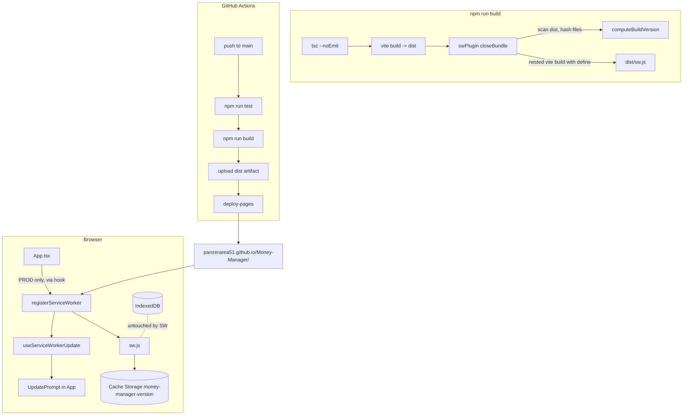

# Design Document: PWA and GitHub Pages Hosting

## Overview

This design makes the existing app installable and offline-capable, and publishes it to `https://panzerarea51.github.io/Money-Manager/` from GitHub Actions. The app stays local-first. Pages serves static files only, and all data stays in IndexedDB.

Decisions:

- **Hand-written service worker, no new dependencies.** The service worker is TypeScript in `src/pwa/sw.ts`. A small Vite plugin in `vite.config.ts` bundles it after the main build and injects the precache list and the cache version.
- **One repository-name constant.** `REPO_NAME = 'Money-Manager'` lives in `src/pwa/repoName.ts`. The Vite `base`, the service worker scope, and the cache name prefix all derive from it. The manifest uses only relative URLs, so it does not depend on the name.
- **Pure helpers.** Base path derivation, cache naming, stale cache selection, build versioning, and request routing are pure functions with unit and property tests. The service worker file only wires them to browser events.
- **Safe updates.** A new worker waits until the user accepts the Update_Prompt. Navigation uses network-first, hashed assets use cache-first, and the worker script itself is never served from the HTTP cache.
- **Icons without dependencies.** A one-off Node script (`scripts/generate-icons.mjs`) draws the icons with `node:zlib` and writes PNGs to `public/icons`. The PNGs are committed, and the script is not part of `npm run build`.
- **Dev unchanged.** `vite dev` serves from `/` and does not register the service worker.

### Findings from the existing project

| Item | Current state | Effect on design |
| --- | --- | --- |
| `vite.config.ts` | `defineConfig` from `vitest/config`, react plugin, test block (`environment: 'node'`) | Add `base`, the SW plugin, keep the test block. |
| `index.html` | No manifest, icons, or theme color | Add links using `%BASE_URL%`. |
| `src/main.tsx` | Renders `ErrorBoundary > FinanceProvider > App` | Unchanged. Registration runs from a hook called in `App`. |
| `src/hooks/useStoragePersistence.ts` | Calls `navigator.storage.persist()`; used by `FinanceProvider` | Unchanged. Satisfies 6.1 and 6.7. |
| `src/components/PersistenceNotice.tsx` | Dismissible notice with `Button` | `UpdatePrompt` copies this pattern. |
| `.github/` | Does not exist | Create `.github/workflows/deploy.yml`. |
| `package.json` | `build` is `tsc --noEmit && vite build`; `fast-check` is already a dev dependency | No new dependencies. Property tests use the existing `fast-check`. |
| `tsconfig.json` | `lib` has DOM, not WebWorker; `include` is `src` and `vite.config.ts` | `sw.ts` declares minimal worker types locally to avoid a DOM/WebWorker conflict. |
| CSS variables | `--color-primary: #1a56c4`, `--color-bg: #f4f5f7` | `theme_color` is `#1a56c4`, `background_color` is `#f4f5f7`. |

Layout note: the project structure rules do not list a `pwa` folder. This design adds `src/pwa/` for PWA code that belongs to no finance layer. If you prefer, the pure helpers can move to `src/utils/` instead.

## Architecture



### Build flow

1. `tsc --noEmit` type-checks `src`, including `src/pwa/sw.ts`.
2. `vite build` writes the app to `dist` with `base: '/Money-Manager/'`. Files in `public/` (manifest, icons) are copied as-is.
3. The plugin's `closeBundle` hook (build only, after the main build) does the following:
   1. Lists every file in `dist` except `sw.js`.
   2. Computes the Cache_Version with `computeBuildVersion` over each file's relative path and bytes.
   3. Runs a nested `vite.build` in library mode (`formats: ['iife']`, output `sw.js`, `emptyOutDir: false`, `configFile: false`) with `define` values for `__PRECACHE_URLS__`, `__CACHE_PREFIX__`, and `__CACHE_VERSION__`.
4. `sw.js` has a fixed name, so the browser can byte-compare it on each load to detect updates.

### Cache strategy

| Request | Strategy | Reason |
| --- | --- | --- |
| Navigation under the Base_Path | Network-first, fall back to cached `index.html` | A fresh `index.html` points at the newest hashed assets. Offline launch still works (4.3, 5.4). |
| `assets/*` under the Base_Path (hashed) | Cache-first, then network (not added to cache) | Hashed files never change. All are precached at install (5.5). |
| Other same-origin files under the Base_Path (manifest, icons) | Cache-first, then network | Precached, rarely change. |
| Cross-origin, or same-origin outside the Base_Path | Not intercepted | The browser handles them (4.5). Pages hosts every project of the user on one origin, so scope matters. |

The cache name is `money-manager-<version>`. Cache Storage is shared across all project sites on `panzerarea51.github.io`, so the prefix includes the repository name. Cleanup then deletes only this app's old caches and never another project's (5.2).

### Update flow

```mermaid
sequenceDiagram
    participant U as User
    participant P as Page
    participant R as Registration
    participant W as New sw.js
    P->>R: register sw.js (scope Base_Path, updateViaCache none)
    R->>W: fetch sw.js from network, byte compare
    W->>W: install: precache into money-manager-NEW
    Note over W: waiting; old worker still controls page
    W-->>P: statechange installed (controller exists)
    P->>U: Update_Prompt
    alt accepts
        U->>P: Update
        P->>W: postMessage SKIP_WAITING
        W->>W: skipWaiting, activate, delete old caches
        W-->>P: controllerchange
        P->>P: reload once
    else dismisses
        U->>P: Later
        Note over P: stays on current version; update applies at next full launch
    end
```

- On the very first install there is no controller, so no prompt is shown.
- The worker never calls `skipWaiting()` on its own and never calls `clients.claim()` before the user accepts. On first install `clients.claim()` is not needed, because the page controls itself on the next load.
- A module-level guard ensures the page reloads at most once per `controllerchange`.
- A dismissed prompt leaves the new worker waiting. It activates when all tabs or windows of the app close and the app is launched again.

## Components and Interfaces

### Files

```
.github/workflows/deploy.yml
docs/DEPLOYMENT.md
docs/INSTALL-ON-PHONE.md
public/manifest.webmanifest
public/icons/icon-192.png
public/icons/icon-512.png
public/icons/icon-maskable-512.png
public/icons/apple-touch-icon.png          (180x180)
scripts/generate-icons.mjs
src/pwa/repoName.ts                        REPO_NAME constant
src/pwa/basePath.ts (+ test)               toBasePath
src/pwa/cacheNames.ts (+ test)             cacheName, staleCacheNames
src/pwa/requestRouting.ts (+ test)         chooseStrategy
src/pwa/buildVersion.ts (+ test)           computeBuildVersion (Node only)
src/pwa/swPlugin.ts                        Vite plugin (Node only)
src/pwa/sw.ts                              service worker entry
src/pwa/register.ts (+ test)              registerServiceWorker, update decision helper
src/pwa/manifest.test.ts                   manifest and index.html checks
src/hooks/useServiceWorkerUpdate.ts        React hook for the update state
src/components/UpdatePrompt.tsx + .css     prompt UI
vite.config.ts                             modified
index.html                                 modified
src/App.tsx                                modified (render UpdatePrompt)
```

### Pure helpers (no globals, no browser or Node imports)

```ts
// src/pwa/repoName.ts
export const REPO_NAME = 'Money-Manager';

// src/pwa/basePath.ts
/** 'Money-Manager', '/Money-Manager', 'Money-Manager/', '/Money-Manager/' -> '/Money-Manager/' */
export function toBasePath(repoName: string): string;

// src/pwa/cacheNames.ts
export function cacheName(prefix: string, version: string): string;      // `${prefix}-${version}`
export function cachePrefix(repoName: string): string;                    // lowercased repo name
/** Names that belong to this app (start with `${prefix}-`) and differ from `current`. */
export function staleCacheNames(allNames: readonly string[], prefix: string, current: string): string[];

// src/pwa/requestRouting.ts
export type Strategy = 'navigation' | 'cache-first' | 'passthrough';
export function chooseStrategy(input: {
  url: string;          // absolute request URL
  mode: string;         // Request.mode
  method: string;       // Request.method
  scope: string;        // absolute scope URL, e.g. https://panzerarea51.github.io/Money-Manager/
}): Strategy;
```

`chooseStrategy` returns `passthrough` for non-GET methods, for a different origin, and for a path outside the scope. Inside the scope it returns `navigation` when `mode === 'navigate'`, and `cache-first` for everything else.

`cachePrefix` lowercases the name because cache names are compared as exact strings and a single canonical form avoids mismatches.

### Node-only build helpers

```ts
// src/pwa/buildVersion.ts
export type BuildFile = { path: string; content: Uint8Array };
/** SHA-256 over the files sorted by path (path and content both hashed), first 12 hex characters. */
export function computeBuildVersion(files: readonly BuildFile[]): string;
```

```ts
// src/pwa/swPlugin.ts
export function swPlugin(options: { repoName: string }): Plugin;
// apply: 'build'. closeBundle: list dist, compute version, nested build of src/pwa/sw.ts -> dist/sw.js.
```

Hashing only 12 hex characters (48 bits) is enough because the version only needs to differ between successive builds of one site.

### vite.config.ts

```ts
import { REPO_NAME } from './src/pwa/repoName';
import { toBasePath } from './src/pwa/basePath';
import { swPlugin } from './src/pwa/swPlugin';

export default defineConfig(({ command }) => ({
  base: command === 'build' ? toBasePath(REPO_NAME) : '/',
  plugins: [react(), swPlugin({ repoName: REPO_NAME })],
  test: { environment: 'node', include: ['src/**/*.test.{ts,tsx}'] },
}));
```

`vitest` runs the config with `command === 'serve'`, so tests see `base: '/'` and the plugin is inert (`apply: 'build'`).

### Service worker (`src/pwa/sw.ts`)

The file declares small local interfaces (`ExtendableEventLike`, `FetchEventLike`, and the worker `self` shape), because the project's `tsconfig` has the DOM lib and adding WebWorker would conflict. Build-time constants:

```ts
declare const __PRECACHE_URLS__: string[];   // relative to scope, e.g. ['./', 'index.html', 'assets/index-ab12.js', ...]
declare const __CACHE_PREFIX__: string;      // 'money-manager'
declare const __CACHE_VERSION__: string;     // '3fa91c0b27de'
```

Events:

- `install`: open `cacheName(prefix, version)`, `addAll` the precache URLs resolved against `self.registration.scope`, using `cache: 'reload'` requests so that the HTTP cache is bypassed. No `skipWaiting()`.
- `message`: when `data.type === 'SKIP_WAITING'`, call `self.skipWaiting()`.
- `activate`: delete `staleCacheNames(await caches.keys(), prefix, current)`, then `clients.claim()`. Claim is safe here because activation only happens after the user accepted, or on first install or full relaunch.
- `fetch`: call `chooseStrategy`. For `passthrough`, return without `respondWith`. For `navigation`, try `fetch(request)`; on failure return `caches.match(scope + 'index.html')`. For `cache-first`, `caches.match(request)` then `fetch(request)`.

The worker only handles `fetch` events and Cache Storage. It never touches IndexedDB (4.6, 5.10).

### Registration and update state

```ts
// src/pwa/register.ts
export type UpdateListener = (apply: () => void) => void;

/** Pure decision: show the prompt only when a worker finished installing and a controller already exists. */
export function shouldPromptForUpdate(workerState: string, hasController: boolean): boolean;

export async function registerServiceWorker(onUpdateReady: UpdateListener): Promise<void>;
```

`registerServiceWorker`:

1. Returns silently when `'serviceWorker' in navigator` is false (4.7).
2. Calls `navigator.serviceWorker.register(`${import.meta.env.BASE_URL}sw.js`, { scope: import.meta.env.BASE_URL, updateViaCache: 'none' })`. A failure is caught and logged with `console.error` (4.8).
3. If `registration.waiting` already exists and a controller exists, calls `onUpdateReady`.
4. Listens for `updatefound`; when the new worker's state becomes `installed`, calls `onUpdateReady` if `shouldPromptForUpdate(state, hasController)`.
5. `apply` posts `{ type: 'SKIP_WAITING' }` to the waiting worker. A single `controllerchange` listener reloads the page once.

```ts
// src/hooks/useServiceWorkerUpdate.ts
export function useServiceWorkerUpdate(): { updateReady: boolean; apply: () => void; dismiss: () => void };
```

The hook keeps `updateReady` and the `apply` callback in state. It runs registration once on mount in production only (`import.meta.env.PROD`). This follows the rule that components stay presentational. `main.tsx` needs no change; `App.tsx` calls the hook and renders `UpdatePrompt`.

```tsx
// src/components/UpdatePrompt.tsx
export function UpdatePrompt(props: { visible: boolean; onUpdate: () => void; onDismiss: () => void }): JSX.Element | null;
```

It renders a non-blocking `role="status"` banner like `PersistenceNotice`: "A new version is available." with "Update" and "Later" buttons (44px touch targets, existing `Button`, prefixed CSS classes `update-prompt__*`). It sits above the tab bar and below modals. `onUpdate` shows no data-changing action, and the page reload keeps IndexedDB intact.

### Manifest and index.html

`public/manifest.webmanifest`:

```json
{
  "name": "Personal Finance Tracker",
  "short_name": "Finance",
  "description": "Local-first personal finance tracker. Data stays on this device.",
  "start_url": "./",
  "scope": "./",
  "display": "standalone",
  "orientation": "portrait",
  "theme_color": "#1a56c4",
  "background_color": "#f4f5f7",
  "icons": [
    { "src": "icons/icon-192.png", "sizes": "192x192", "type": "image/png", "purpose": "any" },
    { "src": "icons/icon-512.png", "sizes": "512x512", "type": "image/png", "purpose": "any" },
    { "src": "icons/icon-maskable-512.png", "sizes": "512x512", "type": "image/png", "purpose": "maskable" }
  ]
}
```

`start_url`, `scope`, and icon `src` values are relative, so they resolve against the manifest URL (`/Money-Manager/manifest.webmanifest`) to the Base_Path with no repository name in the file. `short_name` is "Finance" (7 characters).

`index.html` additions in `<head>`:

```html
<meta name="theme-color" content="#1a56c4" />
<link rel="manifest" href="%BASE_URL%manifest.webmanifest" />
<link rel="icon" type="image/png" href="%BASE_URL%icons/icon-192.png" />
<link rel="apple-touch-icon" href="%BASE_URL%icons/apple-touch-icon.png" />
<meta name="apple-mobile-web-app-capable" content="yes" />
<meta name="apple-mobile-web-app-title" content="Finance" />
```

Vite replaces `%BASE_URL%` with `/` in dev and `/Money-Manager/` in the build. The implementation verifies this in `dist/index.html`. The viewport meta tag stays as is.

### Icons

`scripts/generate-icons.mjs` writes four PNGs using `node:zlib` and a hand-built PNG encoder (signature, IHDR, IDAT, IEND, CRC32). The design is a rounded square in `#1a56c4` with a white coin shape. The maskable variant fills the full square with the background color and keeps the artwork inside the central 80% circle. The script is run manually (`node scripts/generate-icons.mjs`), and the PNGs are committed, so CI needs no image tooling. If the user later supplies their own artwork, the files can be replaced without any code change.

### GitHub Actions (`.github/workflows/deploy.yml`)

```yaml
name: Deploy to GitHub Pages
on:
  push:
    branches: [main]
  workflow_dispatch:
permissions:
  contents: read
  pages: write
  id-token: write
concurrency:
  group: pages
  cancel-in-progress: false
jobs:
  build:
    runs-on: ubuntu-latest
    steps:
      - uses: actions/checkout@v4
      - uses: actions/setup-node@v4
        with:
          node-version: 22
          cache: npm
      - run: npm ci
      - run: npm run test
      - run: npm run build
      - uses: actions/configure-pages@v5
      - uses: actions/upload-pages-artifact@v3
        with:
          path: dist
  deploy:
    needs: build
    runs-on: ubuntu-latest
    environment:
      name: github-pages
      url: ${{ steps.deployment.outputs.page_url }}
    steps:
      - id: deployment
        uses: actions/deploy-pages@v4
```

- A failing test or build stops the `build` job, so `deploy` never runs (7.3, 7.7).
- `cancel-in-progress: false` lets a running deployment finish before the next starts (7.5).
- Only `actions/*` actions are used (7.8). The action major versions are the current ones as of writing and are checked when the file is created.
- Node 22 satisfies the engines of Vite 8 and Vitest 5. This is confirmed at implementation time by running the workflow's commands locally with Node 22.

### Documentation

- `docs/DEPLOYMENT.md`: repository `PanzerArea51/Money-Manager`; steps to push to `main`; Settings > Pages > Source "GitHub Actions"; how to check the Actions tab; final URL `https://panzerarea51.github.io/Money-Manager/`; the private repository note; the statement that the site holds no user data; how to rename the repository (change `REPO_NAME` only, then redeploy).
- `docs/INSTALL-ON-PHONE.md`: Android Chrome install; iPhone Safari Share > Add to Home Screen; first visit must be online; open from the home screen icon on iPhone; browser tab and home screen app can hold separate data; how to apply an update from the prompt.
- Both documents include a "Your data" section: per-device and per-browser, no sync, no backup, clearing site data or uninstalling can delete data, JSON export/import is planned later.

## Data Models

No change to IndexedDB schema, stores, or domain types. No version bump is needed.

New non-persisted shapes:

```ts
type Strategy = 'navigation' | 'cache-first' | 'passthrough';
type BuildFile = { path: string; content: Uint8Array };
type UpdateState = { updateReady: boolean; apply: () => void };   // React state in useServiceWorkerUpdate
```

Cache Storage holds one cache per version: `money-manager-<12 hex chars>`. Each cache contains the precached App_Shell responses. It holds no user data.

## Correctness Properties

*A property is a characteristic or behavior that should hold true across all valid executions of a system-essentially, a formal statement about what the system should do. Properties serve as the bridge between human-readable specifications and machine-verifiable correctness guarantees.*

### Property 1: Base path normalization

For any repository name string `n` (non-empty, no `/` inside) and any amount of leading and trailing slashes around it, `toBasePath` returns exactly `/` + `n` + `/`. Applying `toBasePath` to its own output returns the same string.

**Validates: Requirements 3.2, 11.3**

### Property 2: Build version tracks content

For any list of build files, `computeBuildVersion` gives the same result for any ordering of the list. For any list, changing the content of one file, changing one file's path, adding a file, or removing a file gives a different result.

**Validates: Requirements 5.1, 11.1**

### Property 3: Stale cache selection

For any list of cache names, any prefix, and any current name, `staleCacheNames` returns exactly the names that start with `prefix + '-'` and are not equal to the current name. The result never contains the current name and never contains a name without the prefix. Applying the selection to a list from which the result was already removed returns an empty list.

**Validates: Requirements 5.2, 11.2**

### Property 4: Request routing

For any request URL, method, mode, and scope: if the method is not GET, or the origin differs from the scope's origin, or the path is outside the scope's path, `chooseStrategy` returns `passthrough`. Otherwise it returns `navigation` when the mode is `navigate` and `cache-first` for every other mode.

**Validates: Requirements 4.3, 4.4, 4.5, 5.4, 5.5**

## Error Handling

| Situation | Behavior |
| --- | --- |
| Browser has no service worker support | `registerServiceWorker` returns silently. The app runs online-only (4.7). |
| Registration rejects | Log with `console.error`, app continues (4.8). |
| Precache fetch fails during install | Install rejects, the old worker stays in control, and the browser retries on the next load. |
| Network fails for a navigation | Serve cached `index.html`. If it is missing (never precached), the browser shows its offline error. |
| Network fails for an uncached asset | The fetch rejects and the browser reports the load failure. The app does not invent a fallback response. |
| `controllerchange` fires more than once | Guard flag ensures a single reload. |
| User dismisses the prompt | Waiting worker stays waiting. No data change (5.9). |
| `navigator.storage.persist()` denied | Existing `PersistenceNotice` appears (6.7). |
| Build: `dist` scan or nested build fails | The plugin throws, `npm run build` fails, and the workflow stops before upload. |
| Wrong `REPO_NAME` | Assets and the worker scope point at the wrong path and the site shows a blank page. The deployment guide's checklist covers this. |

## Testing Strategy

Property-based testing applies to the four pure helpers, so Correctness Properties are included. It does not apply to the service worker runtime, the React prompt, the workflow, the icons, or the documentation, which are covered by example tests, build inspection, and manual checks.

**Property tests** use the existing `fast-check` dev dependency, run at least 100 iterations each, and carry a tag comment `Feature: pwa-github-pages, Property N: <text>`. Each property is one test:

| Property | File |
| --- | --- |
| 1 Base path normalization | `src/pwa/basePath.property.test.ts` |
| 2 Build version tracks content | `src/pwa/buildVersion.property.test.ts` |
| 3 Stale cache selection | `src/pwa/cacheNames.property.test.ts` |
| 4 Request routing | `src/pwa/requestRouting.property.test.ts` |

**Unit tests (examples):**

- `basePath.test.ts`: `Money-Manager`, `/Money-Manager/`, `Money-Manager/` all give `/Money-Manager/`.
- `cacheNames.test.ts`: empty list; only the current cache; caches from another project prefix (for example `other-app-123`) are kept (11.2).
- `buildVersion.test.ts`: equal inputs give equal versions; one byte changed gives a different version (11.1).
- `register.test.ts`: `shouldPromptForUpdate('installed', true)` is true, `('installed', false)` is false (first install), other states are false. Registration with no `serviceWorker` in `navigator` resolves without throwing. A rejected `register` is logged and does not throw (4.7, 4.8).
- `manifest.test.ts` (reads files with `node:fs`): manifest fields from Requirement 1, `short_name` length 12 or fewer, six-digit hex colors, three icon entries with `image/png`, `theme-color` in `index.html` equals manifest `theme_color`, `index.html` links the manifest and apple touch icon, each icon file exists with a PNG signature and the declared dimensions (1.1 to 1.8, 2.1 to 2.5, 11.4).
- Optional minimal UI test: `UpdatePrompt` shows the buttons when `visible` is true and renders nothing when false.
- Existing tests run unchanged (10.4).

**Build inspection (run once at implementation, not a recurring test):**

- After `npm run build`: `dist` contains `manifest.webmanifest`, `sw.js`, and `icons/*`; `dist/index.html` references `/Money-Manager/assets/...`, the manifest, and the icons; `dist/sw.js` contains the precache list and the version string; two builds of unchanged source give the same version (3.4, 10.1 to 10.3).

**Manual verification checklist** (documented in `docs/DEPLOYMENT.md`):

1. Open the Pages_Site, check Application > Manifest and Service Workers in devtools, with no installability warnings.
2. Go offline, reload, and confirm accounts and transactions still appear (4.9).
3. Deploy a second build, reload, and confirm the Update_Prompt appears; accept and confirm a single reload and unchanged data (5.6 to 5.10).
4. Dismiss the prompt and confirm the old version keeps running.
5. Install on Android Chrome and iPhone Safari following `docs/INSTALL-ON-PHONE.md`.

## Open Items for Your Review

- **Short name** is "Finance" (the full name "Personal Finance Tracker" is longer than 12 characters). Tell me if you want a different label.
- **Icon artwork** is a generated placeholder (white coin on blue). You can replace the PNGs later without code changes.
- **`src/pwa/` folder** is a small addition to the documented layout.
- **Update checks on resume** are not included. The app checks for a new version when it loads, as the requirements specify. An installed phone app that stays in memory may only check at its next launch.
